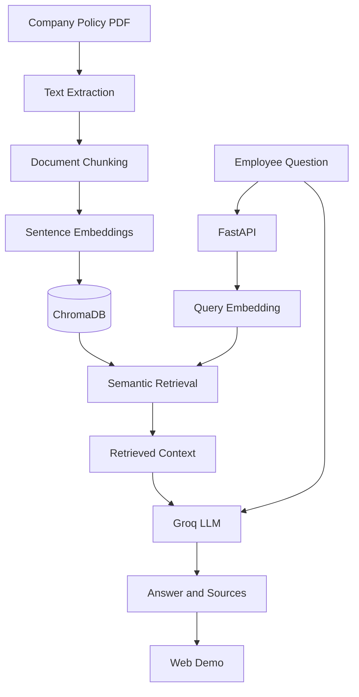

# PolicyMind AI

**An AI-powered company policy assistant built with Retrieval-Augmented Generation (RAG).**

PolicyMind AI helps employees find answers to company policy questions by retrieving relevant passages from policy documents and generating context-grounded responses.

<p align="center">
  <a href="https://mfatur-policymind-ai-demo.static.hf.space">Live Demo</a> ·
  <a href="https://policymind-ai.fastapicloud.dev/docs">API Documentation</a> ·
  <a href="https://github.com/mfatur/PolicyMind-AI">Source Code</a>
</p>

> **Project status:** Deployed portfolio project. The policy document used in the demo is synthetic and intended for learning and experimentation.

## Overview

PolicyMind AI demonstrates how to build and deploy a practical RAG application, from PDF ingestion and semantic retrieval to LLM-based answer generation and API delivery.

The application is designed to ground its responses in retrieved policy content and identify when the available context does not contain the requested information.

## Key Features

- **PDF ingestion:** Extracts text from company policy documents using `pypdf`.
- **Document chunking:** Splits policy content into retrievable sections while preserving source positions.
- **Semantic retrieval:** Uses sentence embeddings and ChromaDB to retrieve relevant passages.
- **Context-grounded generation:** Uses the Groq API to generate answers based on retrieved policy context.
- **Source transparency:** Returns retrieved contexts and source document names alongside the answer.
- **REST API:** Exposes `/health` and `/ask` endpoints through FastAPI.
- **RAG evaluation:** Includes an evaluation workflow using RAGAS metrics.
- **Observability:** Integrates Langfuse instrumentation for tracing supported pipeline operations.
- **Deployment workflow:** Uses Docker and GitHub Actions to support containerization, automated tests, and deployment.

## Architecture



## Technology Stack

| Component | Technology |
|---|---|
| Language | Python 3.11 |
| API framework | FastAPI |
| Document extraction | pypdf |
| Text splitting | LangChain Text Splitters |
| Embedding model | `sentence-transformers/all-MiniLM-L6-v2` |
| Vector database | ChromaDB |
| LLM inference | Groq API |
| Evaluation | RAGAS |
| Observability | Langfuse |
| Containerization | Docker |
| CI/CD | GitHub Actions |
| Demo frontend | HTML, CSS, JavaScript |
| Frontend hosting | Hugging Face Spaces |
| Backend hosting | FastAPI Cloud |

## API Endpoints

Base URL: `https://policymind-ai.fastapicloud.dev`

### Health Check

`GET /health`

Example response:

```json
{
  "status": "ok",
  "service": "PolicyMind AI"
}
```

### Ask a Policy Question

`POST /ask`

Example request:

```json
{
  "question": "Berapa tunjangan komunikasi per bulan?"
}
```

The response contains the original question, generated answer, retrieved contexts, and source document names.

Try the endpoint interactively through the [FastAPI Swagger UI](https://policymind-ai.fastapicloud.dev/docs).

## Local Development

### Prerequisites

- Python 3.11
- Git
- A Groq API key

### 1. Clone the Repository

```bash
git clone https://github.com/mfatur/PolicyMind-AI.git
cd PolicyMind-AI
```

### 2. Create a Virtual Environment

Windows PowerShell:

```powershell
python -m venv .venv
.venv\Scripts\Activate.ps1
```

### 3. Install Dependencies

```powershell
python -m pip install --upgrade pip
pip install -r requirements.txt
```

### 4. Configure Environment Variables

Create a `.env` file in the project root:

```dotenv
GROQ_API_KEY=your_groq_api_key
LANGFUSE_PUBLIC_KEY=your_langfuse_public_key
LANGFUSE_SECRET_KEY=your_langfuse_secret_key
LANGFUSE_HOST=your_langfuse_host
```

Groq credentials are required for answer generation. Langfuse credentials are needed to enable tracing; observability is optional for basic local development.

Never commit `.env` or expose API keys in source code.

### 5. Run the API

```powershell
uvicorn main:app --reload
```

Open `http://127.0.0.1:8000/docs` to explore the API.

The application initializes its vector store during startup. Ensure the required policy PDF is present in `data/raw/` and that the local environment has the dependencies and credentials configured.

## Testing

Run the chunking unit tests with:

```powershell
pytest app/test_chunking_unit.py -v
```

The repository also includes an evaluation workflow for assessing RAG answer quality. Evaluation runs may call external model APIs and consume quota.

## RAG Evaluation

PolicyMind AI uses RAGAS to assess four dimensions of retrieval-augmented generation:

| Metric | What It Measures |
|---|---|
| Faithfulness | Whether the answer is supported by the retrieved context |
| Answer Relevancy | Whether the answer addresses the question |
| Context Precision | How relevant the retrieved context is |
| Context Recall | How much of the reference information is retrieved |

Evaluation scores depend on the dataset, model, prompts, and evaluation configuration. Results from a small synthetic dataset should not be interpreted as evidence of production readiness or performance on real company policies.

## Project Structure

```text
PolicyMind-AI/
├── app/
│   ├── load_documents.py
│   ├── chunking.py
│   ├── embedding.py
│   ├── vector_store.py
│   ├── retrieval.py
│   ├── llm.py
│   ├── rag_pipeline.py
│   └── test_chunking_unit.py
├── data/
│   ├── raw/
│   └── chroma_db/          # Generated local vector database
├── evaluation/
│   ├── evaluate_ragas.py
│   ├── analyze_ragas_errors.py
│   ├── analyze_retrieval_failures.py
│   ├── plot_ragas_per_question.py
│   └── data/
├── frontend/
│   ├── index.html
│   ├── script.js
│   └── style.css
├── .github/
│   └── workflows/
        └── ci.yml
│       └── deploy.yml
├── main.py
├── requirements.txt
├── Dockerfile
└── README.md
```

## Limitations

- The demo uses synthetic company policy data rather than real corporate documents.
- Retrieval and answer quality depend on the source document, retrieval configuration, and LLM behavior.
- RAGAS scores are evaluation signals, not guarantees of correctness.
- This project is an engineering portfolio project, not a replacement for official HR guidance or policy interpretation.

## Future Improvements

- Expand and refine the evaluation dataset.
- Improve retrieval quality and handling of unanswerable questions.
- Strengthen automated testing and production monitoring.
- Document evaluation findings and limitations as experiments progress.

## Author

**Muhammad Faturrahman** — AI Engineer focused on Generative AI, LLM applications, and RAG systems.

- [GitHub](https://github.com/mfatur)
- [LinkedIn](https://linkedin.com/in/mfaturr/)

---

© 2026 Muhammad Faturrahman. All rights reserved.
